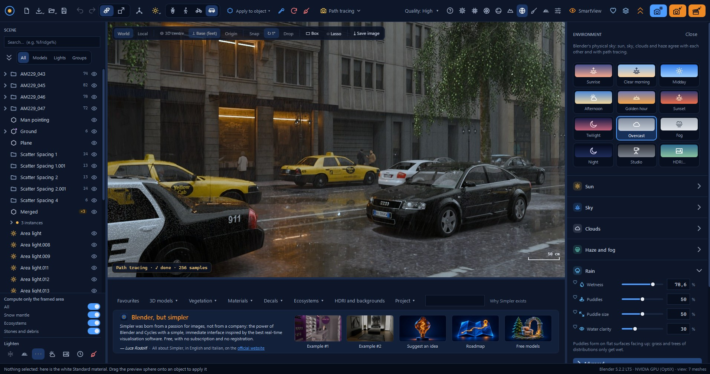

# Simpler

**Photorealistic still-image rendering made simple, built on Blender/Cycles.**

Website: <https://www.rodluc.com/simpler/en/> · Author: Luca Rodolfi · License: GNU GPL version 3 or later

Simpler is a Windows application for making photorealistic images without learning a professional 3D package.
The interface (WPF) shows the scene in real time (three.js in WebView2); the final render is done by Cycles, inside
a copy of Blender used as a headless engine. The interface is available in English and Italian.

## Repository layout

| Folder | Contents |
|---|---|
| `app/Simpler/` | The Windows app `Simpler.exe` (C#, WPF, .NET 8, WebView2) and the real-time 3D view (`web/`) |
| `engine/` | The engine: Python code running inside Blender 5.2, exposing a local API to the app |
| `tools/` | Automated tests and development tools |
| `Simpler setup/` | The installer script (Inno Setup) |
| `release-notes/` | Release notes of every version (English in `release-notes/en/`) |
| `credits/` | License terms and credits (English in `credits/en/`) |

## Building

Requirements: Windows 10/11, [.NET 8 SDK](https://dotnet.microsoft.com/download), [Blender 5.2](https://www.blender.org/download/).

1. Run `Build-App.bat`: it builds the app into `dist\` and starts it.
2. Simpler uses the copy of Blender in a `blender\` folder next to `Simpler.exe` (as installed by the setup);
   otherwise the one installed in `C:\Program Files\Blender Foundation\Blender 5.x`.
3. Installer (optional): `Simpler setup\Build-Setup.bat`, with Inno Setup installed.

## Not in this repository

- The **contents** (3D models, materials, packs, samples): they are not code, they have their own licenses
  (see `credits/`) and are downloaded from within the app.
- The **cloud contents address**: in these sources its secret part is replaced by `SEGRETO-NON-PUBBLICATO`; a build
  from these sources works, without content downloads.
- The author's private tools (pack preparation) and the code of the website's services.

## Source language

Code comments are in English. The interface texts are written in Italian in the source (`L.T("…")`) and translated
into English in `app/Simpler/L.En.cs`.

## License

Simpler's code is © 2026 Luca Rodolfi, released under the **GNU General Public License version 3 or, at your
option, any later version** (see `LICENSE`). Contents, name and logo are covered by `credits/en/License.md`.
Blender is GPL and is used as a separate, unmodified program; Cycles is Apache 2.0; the bundled libraries
(three.js, meshoptimizer and others) keep their own licenses, in the files next to them.
